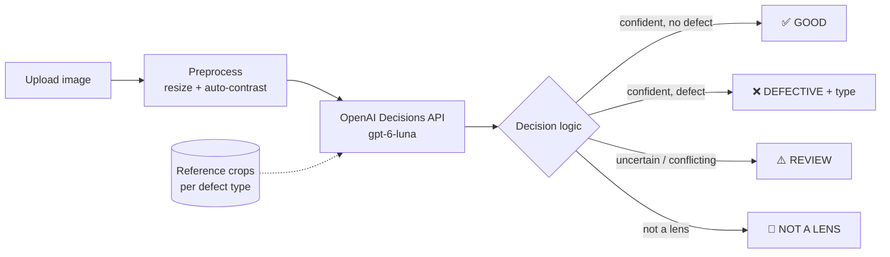

# 🔍 Contact Lens Defect Inspector

An MVP that inspects contact-lens images and decides if each lens is **Good**, **Defective** or
**Needs manual review**. For a defective lens it also names the defect type (Scratch, Collapse,
Digs, Glass Stick or Internal Crack) and how severe it is.

It is built with **Streamlit** and the **[OpenAI Decisions API](https://developers.openai.com/api/docs/guides/decisions)**
(`gpt-6-luna`). The model is not trained or fine-tuned. You describe the categories in plain
language, and a few labelled example images improve accuracy.

<!-- Add a screenshot of the app here: docs/screenshot.png -->
<!--  -->

---

## ✨ Features

- **Upload a raw image** (PNG, JPG, BMP or TIFF) and get a verdict in seconds
- **Four-part decision** in a single API call: is it a lens, is it defective, which defect type, how severe
- **Built-in caution:** sends unclear cases to manual review instead of guessing
- **Few-shot reference images:** labelled defect crops sent with each request roughly double defect-type accuracy
- **Adjustable thresholds** in the sidebar
- **Evaluation script** that measures accuracy on a labelled dataset
- **Low cost:** about **$0.0003–0.0006 per image** (the Decisions API bills input tokens only, at $0.10 per 1M)

## 🧠 How it works



Each request asks four typed questions:

| Question | Type | Returns |
|---|---|---|
| `is_contact_lens` | predicate | probability that the image shows a contact lens |
| `has_defect` | predicate | probability that the lens has any defect |
| `defect_type` | choice | `good`, `scratch`, `collapse`, `digs`, `glass_stick`, `internal_crack` or `other_defect`, with probabilities and confidence |
| `severity` | score | None → Cosmetic → Major → Critical |

A lens goes to **REVIEW** when any of these is true:
- its defect probability is close to the threshold
- `has_defect` and `defect_type` disagree
- the model's confidence in the defect type is low

## 📊 Dataset

[**lens_defect** by lensdefect on Roboflow Universe](https://universe.roboflow.com/lensdefect/lens_defect-fu5gp) (version 8, CC BY 4.0)

- 243 source images of contact lenses (551 after Roboflow's 3× augmentation of the train split)
- 5 defect classes: Scratch, Collapse, Digs, Glass Stick, Internal Crack
- Labelled for instance segmentation. This project uses the labels to evaluate accuracy and to cut example crops.

> The dataset is **not** included in this repo. Download it with `download_data.py` (see below).

## 📈 Results

Evaluated on the 44-image test split. The model was not trained on this data.

| Setup | Defect type correct | Good vs. defect correct | Sent to review | Cost |
|---|---|---|---|---|
| No examples | 23% | 100% | 57% | $0.014 |
| **With reference crops** | **48%** | 100% | 68% | $0.026 |

- Without examples the model labels most defects "Digs". The reference crops mainly fix Internal Crack, Collapse and Scratch.
- The model's confidence tells you something: when it is at least 50% confident, the defect type is right 64% of the time, versus 40% when it is less confident.
- ⚠️ **The test split contains no good lenses**, so this evaluation does not measure how often good lenses are wrongly rejected. See Limitations below.

## 🚀 Getting started

### 1. Clone and install
```bash
git clone https://github.com/<your-username>/<repo-name>.git
cd <repo-name>
python -m venv .venv
.venv\Scripts\activate          # Windows
# source .venv/bin/activate     # macOS / Linux
pip install -r requirements.txt
```
You need Python 3.10 or later and `openai` 3.26.0 or later. Older SDK versions don't include the Decisions API.

### 2. Add your API keys
```bash
cp .env.example .env
```
Then edit `.env`:
```env
OPENAI_API_KEY=sk-...
ROBOFLOW_API_KEY=...        # only needed to download the dataset
```

### 3. (Optional) Download the dataset and build reference crops
```bash
python download_data.py      # saves to data/lens_defect-8/ (~700 MB)
python make_references.py    # saves 2 crops per defect type to references/
```
This repo already includes the reference crops, so you can skip this step to just run the app.

### 4. Run the app
```bash
streamlit run app.py
```
Then open http://localhost:8501 and upload a lens image.

### 5. Evaluate
```bash
python evaluate.py data/lens_defect-8/test --refs --out eval_refs.csv
python evaluate.py data/lens_defect-8/test --limit 10      # quick run without example crops
```

## 🗂️ Project structure

```
├── app.py                # Streamlit UI
├── lens_classifier.py    # Decisions API questions, preprocessing and verdict logic
├── evaluate.py           # accuracy on a Roboflow COCO export
├── download_data.py      # downloads the Roboflow dataset into data/
├── make_references.py    # cuts labelled defect crops for few-shot examples
├── references/           # few-shot crops, one folder per defect type
├── requirements.txt
└── .env.example          # template for API keys
```

## ⚙️ Configuration

| Setting | Where | Default |
|---|---|---|
| Model | `OPENAI_DECISION_MODEL` env var | `gpt-6-luna` |
| Image detail | sidebar | `high` (defects are often only a few pixels wide) |
| Auto-contrast | sidebar | on |
| Reference examples | sidebar | on |
| Defect threshold / review band / min. confidence | sidebar | 0.50 / ±0.15 / 0.50 |

## ⚠️ Limitations

- **No good-lens images in the dataset.** Good-lens accuracy (how often good lenses are wrongly rejected) has not been measured.
- **Defect-type accuracy is moderate (about 48%).** Treat the defect type as a hint. The good-or-defective decision is the more reliable output.
- **Small test set (44 images)** from one camera setup. Results may differ with other cameras or lighting.
- The Decisions API is in **public beta**, so the API or its behaviour may change.
- This is an MVP for experiments. **Do not use it as a validated medical-device QC system.**

## 🛣️ Roadmap

- [ ] Collect good-lens images and measure the false-reject rate
- [ ] Add "good" reference examples
- [ ] Upload and inspect many images at once, with a CSV export
- [ ] Highlight where the defect is (for example, combine with a segmentation model)
- [ ] Docker image and cloud deployment

## 🙏 Acknowledgements

- Dataset: *lens_defect* by **lensdefect**, [Roboflow Universe](https://universe.roboflow.com/lensdefect/lens_defect-fu5gp), licensed under [CC BY 4.0](https://creativecommons.org/licenses/by/4.0/). The images in `references/` are crops from this dataset.
- [OpenAI Decisions API](https://developers.openai.com/api/docs/guides/decisions)
- [Streamlit](https://streamlit.io)

## 📄 License

Code: MIT (see `LICENSE`). Dataset images and the crops made from them remain under CC BY 4.0.
